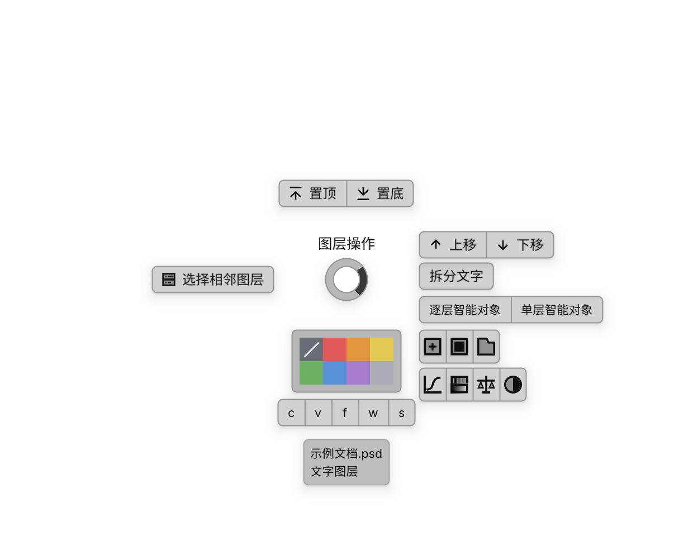

# Photoshop Menu

为 Windows Photoshop 提供随鼠标唤出的快捷菜单。按 **CapsLock**，就近完成选层、排序、标色、新建、调色、智能对象转换和文字拆分；按 **F** 搜索图层。

**[下载最新版](https://github.com/mianxiu/15100px-menu/releases/latest) · [快速开始](https://github.com/mianxiu/15100px-menu/wiki/Quick-start) · [完整文档](https://github.com/mianxiu/15100px-menu/wiki) · [反馈问题](https://github.com/mianxiu/15100px-menu/issues)**

## 主要功能

| 功能 | 使用方式 |
| --- | --- |
| 就近操作图层 | Caps 菜单提供选择、组内／文档排序、颜色标签与创建按钮 |
| 图层搜索 | 单独 F 打开搜索框，输入名称、点击类型标签，再定位结果 |
| 智能对象 | 每个选中层分别转换，或将同组多选合成一个对象 |
| 文本拆分 | 把一个文字层按行分组，生成多个可编辑文字层 |
| 颜色与蒙版 | 编辑填充、描边、渐变、羽化／密度，支持相应预览与取消 |
| 后台管理 | 配置快捷键、管理 PS 执行插件、更新、查看任务与导出诊断 |

菜单根据鼠标区域、图层类型和选择数量显示可用操作。**短按 CapsLock 固定后点击；长按划向按钮后松开执行，回中心或空白处松开取消。**

## 菜单示例

图为 0.4.254 原生渲染示例，不是 PS 实屏截图；按钮随当前目标变化。

## 安装使用

需要 **Windows 10／11 x64**。Photoshop 声明最低版本为 **23.3.0**，目前较完整的本机功能验证在 **PS 24.0.1**；其他版本和硬件的边界见[安装与兼容性](https://github.com/mianxiu/15100px-menu/wiki/Installation)。

1. 下载 `PhotoshopMenu-Backend-<版本>.zip`，完整解压并运行 `PhotoshopMenu.exe`。
2. 双击托盘图标打开后台，保存文档并正常关闭 PS，在“插件管理”安装内置执行插件。
3. 手动启动 PS，确认实际加载插件已连接且版本一致。
4. 在 PS 中按 CapsLock，按[快速开始](https://github.com/mianxiu/15100px-menu/wiki/Quick-start)完成第一次操作。

发行包包含运行时，无需另装 Python、Node.js 或 Adobe 开发工具。主程序与 PS 插件使用本机通信；后台默认地址为 [http://127.0.0.1:15151/](http://127.0.0.1:15151/)。

## 查找说明

[菜单与默认按键](https://github.com/mianxiu/15100px-menu/wiki/Menu-guide) · [颜色与蒙版](https://github.com/mianxiu/15100px-menu/wiki/Mask-preview) · [更新方法](https://github.com/mianxiu/15100px-menu/wiki/Updates) · [故障排查](https://github.com/mianxiu/15100px-menu/wiki/Troubleshooting)

正式下载与开发候选分开说明，见[版本状态](https://github.com/mianxiu/15100px-menu/wiki/Versions)。源码中可能包含尚未发布的改动。

开发者从[开发与构建](https://github.com/mianxiu/15100px-menu/wiki/Development)进入；后续 UI 遵循[共享规范](docs/UI-GUIDE.md)，文档遵循[写作规范](docs/DOCUMENTATION.md)。开发待办和历史变更分别记录在 [TODO](TODO.md) 与 [RELEASES](RELEASES.md)。

## 许可

[MIT](LICENSE)。第三方库、字体和运行时适用各自许可，见[第三方声明](THIRD_PARTY_NOTICES.md)。
