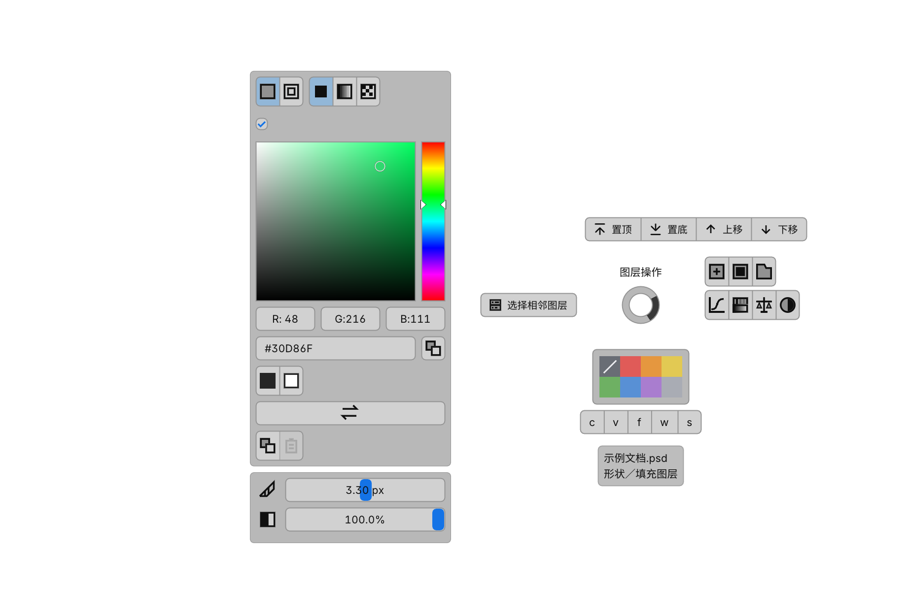
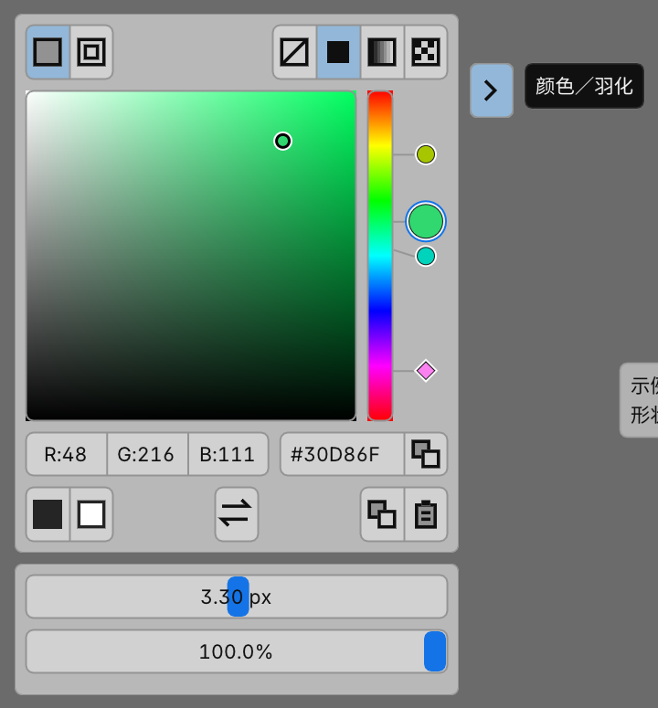
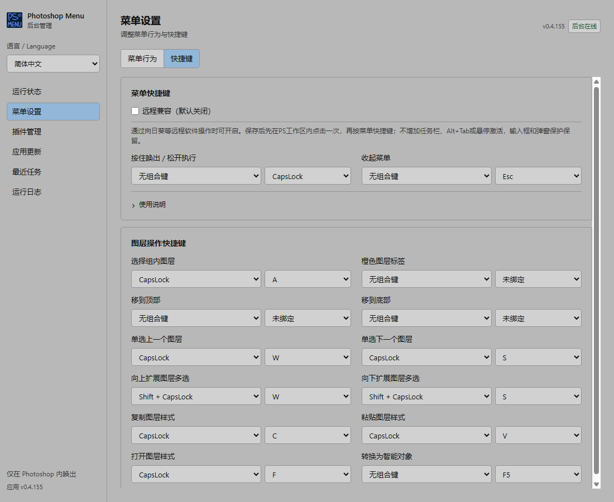

# Photoshop Menu

219已构建并更新本机实际入口，UXP0.3.52；发布核验进行中。七项创建的原生读取策略省去被丢弃的DOM反馈快照，完成前的新鲜核验保持；[速度对照及实测范围](https://github.com/mianxiu/15100px-menu/wiki/Layer-performance)。

以下为历史交付记录，反映当时状态；旧版链接指向保留的源码标签，发行页只保留最新版。

[218已发布并更新本机](https://github.com/mianxiu/15100px-menu/tree/v0.4.218)，UXP仍0.3.51：任务运行中按Caps打开的图层运行菜单，成功后经新鲜目标核验自动恢复固定普通菜单；公开ZIP／SHA／Latest清单及Wiki已核验。[操作与验证范围](https://github.com/mianxiu/15100px-menu/wiki/Menu-guide)。

[217已发布并更新本机](https://github.com/mianxiu/15100px-menu/tree/v0.4.217)，UXP仍0.3.51：自动测试保留原报告，增加核验后的原测试文档收尾，中文显示失败阶段及原始错误详情；ZIP／SHA／Latest清单公开核验通过。[使用和验证范围](https://github.com/mianxiu/15100px-menu/wiki/Stability-test)。

[216／UXP0.3.51已发布并更新本机](https://github.com/mianxiu/15100px-menu/tree/v0.4.216)：24.2.x常见根级单选按需读取邻层，组／多选保留有界全树；ZIP、SHA和更新清单公开下载通过。[读取策略和验证范围](https://github.com/mianxiu/15100px-menu/wiki/Layer-performance)。

[0.4.215已发布并更新本机](https://github.com/mianxiu/15100px-menu/tree/v0.4.215)：主题和字号每次PS启动只读取一次成功值，运行期间不轮询；实际需要UXP0.3.50。[操作与验证范围](https://github.com/mianxiu/15100px-menu/wiki/Layer-performance)。

[0.4.214已发布并更新本机](https://github.com/mianxiu/15100px-menu/tree/v0.4.214)：UXP0.3.49将后台主题／文档元数据读取放到菜单和命令之后，存活心跳保留独立元数据时间。实际48需正常关闭PS后更新内置49再手动启动；[性能与验证范围](https://github.com/mianxiu/15100px-menu/wiki/Layer-performance)。

[0.4.213已发布并更新本机](https://github.com/mianxiu/15100px-menu/tree/v0.4.213)：菜单空白处右键关闭，屏幕取色时右键先取消取色。UXP仍0.3.48，不需重启PS；[操作与验证范围](https://github.com/mianxiu/15100px-menu/wiki/Mask-preview)。

210本机修正24.2首页“当前文档不可用”弹窗；故障机需实际加载UXP0.3.48。[安装说明](https://github.com/mianxiu/15100px-menu/wiki/Stability-test)。[最新版本已发布](https://github.com/mianxiu/15100px-menu/releases/latest)。

本机209修正取色后重新hover收起：确认调整后返回普通菜单继续操作。UXP仍为0.3.47，未新增Release；实体鼠标和其他宿主待验。[说明](https://github.com/mianxiu/15100px-menu/wiki/Mask-preview)。

[208已发布](https://github.com/mianxiu/15100px-menu/tree/v0.4.208)／UXP0.3.47：针对PS24.2.x逐属性DOM读取延迟，改用有界批量标量读取与新鲜身份核对，沿用原能力算法和写前校验；仅显式颜色元数据采用短时只读模态。自动测试补齐标准54次／持续180次原生菜单显示、请求／接收、按钮能力、内容帧和收起，记录心跳失鲜及最后菜单观测。需保存文档、正常关闭PS后更新内置UXP，再手动启动并确认实际0.3.47。

[使用说明和验证边界](https://github.com/mianxiu/15100px-menu/wiki/Stability-test)。PS24.2.0故障机仍待复测；实体Caps、UU远程及调色面板提前关闭未计为已修复。以下为此前版本记录。

[v0.4.207已发布](https://github.com/mianxiu/15100px-menu/tree/v0.4.207)／UXP0.3.46新增后台一键自动稳定性测试，自动生成图层读取、持续操作及系统负载报告。[使用方法与验证限制](https://github.com/mianxiu/15100px-menu/wiki/Stability-test)；故障机持续卡顿和UU远程Caps双按仍待定位。

以下为历史版本变更。

v0.4.206／UXP45已完成本机更新：修正慢图层读取让行、首份快照等待及预览遗留文件清理。两台Win11故障机待验收，公开Release仍205；操作与限制见[Wiki](https://github.com/mianxiu/15100px-menu/wiki/Layer-performance)。

v0.4.201：展开／收起统一悬停原按钮，说明文字保留，外框恢复实线。用法与验证范围见[Wiki](https://github.com/mianxiu/15100px-menu/wiki/Perceptual-color)。

v0.4.200：展开／收起按钮增加状态说明文字及圆角虚线描边，沿用点击收起与屏幕取色保护。用法和验证范围见[Wiki](https://github.com/mianxiu/15100px-menu/wiki/Perceptual-color)。

v0.4.199：颜色／羽化面板仅点击原图标收起，屏幕取色后往返保持展开。用法与验证限制见[Wiki](https://github.com/mianxiu/15100px-menu/wiki/Perceptual-color)。

本机v0.4.197将所有成功反馈统一为勾号短暂停留后自动收起菜单，使用说明见[Wiki菜单指南](https://github.com/mianxiu/15100px-menu/wiki/Menu-guide)。

本机v0.4.196已增加屏幕吸管、完整面板连接通道及拖动后保持展开；操作与验证范围见[Wiki取色说明](https://github.com/mianxiu/15100px-menu/wiki/Perceptual-color)。

为 Windows Photoshop 提供随鼠标唤出的快捷菜单，让选层、排序、创建图层与调色更顺手。

[下载最新版](https://github.com/mianxiu/15100px-menu/releases/latest) · [使用文档](https://github.com/mianxiu/15100px-menu/wiki) · [安装指南](https://github.com/mianxiu/15100px-menu/wiki/Installation) · [反馈问题](https://github.com/mianxiu/15100px-menu/issues)

## 主要功能

- **随处唤出**：按 CapsLock 打开环绕菜单，根据画布、图层面板或首页显示对应操作。
- **快速处理图层**：选择相邻／组内图层、置顶置底、上下移动、颜色标签、复制粘贴样式及转换智能对象。
- **创建与调色**：新建空白、填充与调整图层；方块取色、按形状区分的联动感知配色与渐变、形状填充／描边复制并批量粘贴，羽化／密度支持拖动和数值输入；悬停展开调色面板，实时预览、取消恢复及范围见 [Wiki](https://github.com/mianxiu/15100px-menu/wiki/Shape-paint-clipboard)。
- **版本自动自检**：版本或能力变化后自动检查、异常留证，在后台查看与导出；[范围与限制](https://github.com/mianxiu/15100px-menu/wiki/Version-health)。
- **独立后台管理**：下拉配置快捷键，管理本地插件、检查更新、查看任务和导出诊断；菜单与后台跟随 PS 明暗主题。

## 界面预览

**图层快捷菜单**

**悬停展开调色面板**

**后台快捷键设置**

菜单图为v0.4.194原生渲染器的示例导出；后台图来自 v0.4.155 实际运行页面。

## 开始使用

需要 **Windows 10／11 x64**；v0.4.198起声明最低 **Photoshop 23.3.0／UXP6.0**（23.x实机待验，当前已验PS24.0.1）。版本兼容与已知限制见 [Wiki](https://github.com/mianxiu/15100px-menu/wiki/Installation)。

1. 从 [Release](https://github.com/mianxiu/15100px-menu/releases/latest) 下载 `PhotoshopMenu-Backend-<版本>.zip`，解压并运行 `PhotoshopMenu.exe`，无需安装 Python 或 Node.js。
2. 双击托盘图标打开后台，在「插件管理」按提示安装内置 UXP 插件，重新打开 PS，确认已连接。
3. 在 PS 画布或图层面板按 **CapsLock**：短按固定菜单，长按划向操作后松键执行；回中心或按 Esc 取消。

## 更多说明

[操作与默认快捷键](https://github.com/mianxiu/15100px-menu/wiki/Menu-guide) · [插件安装与更新](https://github.com/mianxiu/15100px-menu/wiki/Installation) · [故障排查](https://github.com/mianxiu/15100px-menu/wiki/Troubleshooting) · [开发与构建](https://github.com/mianxiu/15100px-menu/wiki/Development)

详细用法、性能测试、已知限制和[历史记录](https://github.com/mianxiu/15100px-menu/wiki/Readme-archive-2026-10-17)统一收录于 Wiki；开发待办见 [TODO](TODO.md)。

## 许可

[MIT](LICENSE)。第三方库与字体遵循各自许可，见[第三方许可说明](THIRD_PARTY_NOTICES.md)。
