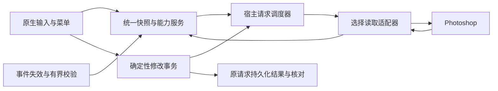

# 208 架构审查：图层读取、菜单响应与兼容策略

## 后续优化：后台准备与按动作最少读取（2026-10-20，待实施）

用户新增方向：利用合适的后台时机提前准备，减少无谓读取，让全部菜单操作尽量没有等待感。以下为以218／UXP51为基线的实施路线，不是已上线功能或零延迟承诺。

先审查当前链路：现有UXP在通知中将contextReadAt归零，同时仍按100–1000ms自适应周期读取基本能力；这不能视为已经实现精确失效或有效预取。通知注册使用旧式{event}数组且仅同步try/catch，而当前[Adobe action接口](https://developer.adobe.com/photoshop/uxp/2022/ps-reference/media/photoshopaction)列出string[]及Promise返回值。先用真实宿主核验注册成功、回调覆盖及异常可见性；参数差异是待核验风险，不能据此宣称当前通知必然失败。不能直接套用此前已变慢的“事件+1秒兜底”配置。

| 数据／场景 | 提前准备的内容 | 失效与提交边界 |
|---|---|---|
| 字体、图标、主题、共享布局 | 启动预热，复用已成功的会话设置和几何 | 主题／字号沿用每次PS启动读取一次；不增加Caps热路径查询 |
| 当前文档、选择与基本按钮 | 有变化时仅标记相关部分失效，在允许的空闲片段补齐当前目标的最小字段 | 会话、文档ID、选择ID、代次与原采样时间分开；缓存本身不授权修改 |
| 选层、标签、排序、创建及样式操作 | 建立逐动作必读字段清单，复用可信完成结果中的新鲜读回；拓扑只读必要邻层／父组 | 写前按动作核验真实身份、锁、位置等必要条件；完整结构确实必要时不省略 |
| 颜色、描边、蒙版、渐变及图案 | 仅已确认支持的当前目标、相关面板有实际使用可能时预取；目录与可变参数分离 | 背景不进入只读模态来预热，不持续读取所有图层样式；编辑前核验revision和目标 |
| 首页预设、剪贴板与通用／画布菜单 | 复用布局和本地数据，按真实版本／剪贴板序号处理变化，独立于图层树 | 大图转换放独立工作线程；实际使用时核验当前内容／文档范围，未知目标不启用旧命中 |

“预知”指依据已知上下文准备可能需要的数据，不预测并执行用户下一条命令。事件回调只标记失效或消费有明确契约的字段，不同步遍历PS对象；[Adobe事件分类](https://developer.adobe.com/photoshop/uxp/2022/ps-reference/media/eventcodes)用于核验文档变化与UI事件，通知可能不完整或在模态期受影响，不能成为唯一权威。结合既有面板／菜单状态判断预取需求，不在键盘钩子查询UIA／COM／UXP，不新增追踪输入文字的逻辑。

统一调度顺序：原事务确认／恢复 → 已接受修改 → 当前交互必读 → 当前目标的低成本预取 → 可选编辑数据／目录 → 后台观察。后台只保留一个最新未发送需求，重复事件合并；新交互出现时立即撤销尚未开始的预取，已发出的宿主调用必须等待返回，在安全检查点让行。修改仍忙碌拒绝、不排队、不猜测执行，不为预取申请模态独占，也不并发写PS。[Adobe模态规则](https://developer.adobe.com/photoshop/uxp/2022/ps-reference/media/executeasmodal)约束实际修改；独立文件I/O、转换、报告与布局计算才考虑线程分工。

快照服务统一管理“当前选择、基本能力、局部拓扑、编辑参数、目录”，各部分保留原时间、完整性和失效代次。写后读回、后台读取、菜单请求共用同一份可证明有效的结果，避免连着全读三遍；但必须先证明覆盖了相同字段和目标。218恢复菜单的新鲜目标门槛及既有hover返回规则保留，只有真实代次／身份核验成立时才能减少重复读取。迟到结果不得覆盖新选择，心跳不刷新数据年龄。

实施顺序：①核验通知与读取计数，统一数据／逐动作契约；②收敛重复快照与写后反馈读取；③隔离原型评估当前目标的低成本后台预取；④按收益扩大到编辑面板／预设／剪贴板；⑤处理菜单锁、序列化与有接收确认的有界IPC，覆盖hover返回和busy唤醒的轮次衔接；⑥验证长期资源有界。只读缓存可有界回收，修改防重放身份和未知记录不得按LRU淘汰。

以218同场景作基线，记录每次有效操作的宿主调用数、字段数、返回量、重复读取、有效预取命中、未使用预取成本、后台占用交互的最长时间，以及首帧／能力就绪／宿主执行／反馈的中位数、P95、最大值。后台预取只有减少实际等待且不使P95／最大阻塞恶化才推广；不以CPU看起来空闲、缓存命中率高或减少刷新频率替代结果。实体按键到屏幕延迟另测，不承诺PS真实写入零耗时。

验收覆盖所有菜单家族及直接快捷键，4／100／300层、固定与增层文档、冷启动、闲置首触发、连续操作、切文档／选择、预览确认／取消和后台读取重叠。先低CPU短批次再正常配置，PS24.2原硬件和其他宿主实机单列；错目标、重复执行、未知结果重发为零，前台／输入／取消保护、一次撤销与资源恢复保持。每批按实现→测试→构建→实际入口→Wiki／Release交付，不一次性重写全部链路。

218已公开发布并更新本机实际入口，UXP仍0.3.51；ZIP／SHA／Latest清单及Wiki匿名核验通过，只保留218 Release，旧标签／历史保留。已有UXP51不需要重启PS。

218修复“任务运行中按Caps打开的运行菜单，任务成功结束后没有恢复普通菜单”。图层区短按Caps打开运行圆环并保持窗口时，成功反馈约450毫秒后发出一份新鲜图层快照请求；基本能力就绪便恢复固定普通菜单，可选颜色信息随后按同一请求更新。恢复会轮换菜单轮次、清除旧命中和旧松键状态，不额外提交PS操作。

仅同一仍显示的运行菜单请求恢复；失败、未知结果、预览保护未解除、按住Caps／鼠标、输入保护、关闭或切走应用时不恢复，不激活PS或重开已隐藏窗口。普通菜单提交操作后的反馈沿用既有规则；此次处理运行中再次按Caps打开的菜单。画布／首页／通用菜单保持各自紧凑反馈规则。

恢复逻辑共用，不按PS版本分支，仍使用各宿主既有的受校验读取路径。505项后端／原生回归通过，包括23.3、24.0、24.2、25.5状态契约、生产SetWindowPos显示、实际内容／按钮、失败／未知／输入／旧轮次／重复／隐藏拒绝，以及新鲜basic先恢复、可选completed后续更新。这里的多版本状态契约是模拟，不能代替对应宿主实机。

本机实际218／UXP0.3.51及内置菜单、热键组件已核验；真实PS24.0.1在隔离临时文档完成低CPU双逻辑处理器／Below Normal两次、正常配置两次原请求操作，核验运行圆环→成功反馈→新鲜目标的固定普通菜单及可见内容／按钮，图层ID随真实新建变化，原文档和CPU资源已恢复，无意外提交和未知请求。这是程序化唤起／接口验收，实体Caps、PS24.2与其他宿主实机仍待复测。

UXP仍0.3.51，已有51仅更新主程序即可，不需要重启PS。主题和字号继续按PS启动会话缓存。

217已公开发布并切换本机实际入口，UXP仍0.3.51；ZIP／SHA／Latest更新清单和Wiki匿名核验通过，Release页仅保留217，旧标签／源码历史保持。已有UXP51不需要重启PS。

验证：503项后端回归、42项前端检查、冻结EXE启动／重启及实际217／UXP51／菜单热键组件核验通过。最终真实PS24.0.1低CPU批次在6步／2次菜单读取后因前台变化停止；正常配置在8个完成步骤后主动停止，3次完整菜单读取，另一次读取中停止。两批分别验证原报告不被覆盖、同会话原所有者收尾、原文档恢复，以及收尾后新一轮测试可启动；CPU资源、配置和旧未知记录保持。以上是恢复链路验收，非标准117步／54次菜单完整通过，实体鼠标／Caps与PS24.2此功能仍待验证。界面截图工具因CreateProcessSecurityEnvironment错误未能启动，视觉验收未完成。

217修复自动稳定性测试的两处问题：原测试安全停止后保留的临时文档会阻止下一次创建；界面“已停止”曾早于报告保存和操作锁释放。现在同会话的已核验原测试仍保留时，开始新测试会明确拒绝并保留原报告；结束状态在收尾和锁释放后同步。

后台新增“结束上次测试文档”：先导出报告，再点击该按钮，核验原运行ID、UXP会话、文档／选择／历史和原文档未变后，仅关闭原测试临时文档并恢复原活动文档。完成后可以重新开始测试。它不是强制清理：原请求未知、读取未得到终态、会话／目标变化或缺少所有权证据时拒绝；不清除busy或未知记录、不重发。成功收尾标为cleaned，保留原测试步骤和错误，不冒充整轮测试通过。

英文失败改为中文说明、失败阶段和处理建议，原始错误保留在“错误详情”和导出的报告中；正常手动停止和前台保护停止使用普通状态文字。没有拿到用户上次英文原文，不能认定以上就是当时全部原因。

UXP仍0.3.51，已有51只需更新主程序，不需要重启PS；图层读取策略和主题／字号启动缓存保持。PS24.2用户已反馈目前测试正常，具体版本与持续时间未附；不将自动测试修复泛化为所有硬件长期稳定。

216已公开发布，ZIP／SHA／Latest更新清单匿名核验通过，Wiki已同步，Release页仅保留216，旧标签与源码保留。实际本机216／UXP51，原文档／CPU／配置／未知记录保护保持。

2026-10-20用户最新反馈：“ps24.2目前测试没问题”。记为用户本次复测正常；该条未附主程序／UXP版本、测试时长和原始报告，不绑定为216单独修复结论，也不外推所有故障机或长期稳定性。继续观察原先持续操作后逐渐变慢场景。

最终组合的生产检查点对照：低CPU4层完整／自适应中位数25／25ms、P95 34／27ms；正常配置4层21／20ms、P95均22ms，各策略9样本。两批在额外功能检查期间因前台变化安全停止，非全批通过；其原所有者临时文档随后正常关闭，原文档恢复，无未知请求。低CPU100／300层全批完成；正常100层在发布任何宿主请求前因前台范围不允许停止，300层未启动。216新一轮程序化54次菜单循环及实体键鼠未重跑，不以此前211／214的菜单结果充当216通过。495回归包含原生显示／隐藏生产API及可见内容检查，仍不能代替真实PS交互验收。

216／UXP0.3.51：PS24.2.x 的常见根级普通单选改为按需读取当前层和最多两个邻层，并重新核对身份、位置、锁、模式和位深；宿主返回的图层记录最多6条，不再随100／300层无关图层增长。8条以内保留原有界全树路径，组、子层、多选和结构不确定时仍用原全树读取；身份变化或取消不触发替代读取。其他PS版本仍沿用已有策略，未扩展为全版本默认。

主题和字号沿用215的启动会话缓存，写前新鲜校验、忙碌拒绝、未知结果不重发保持。需要保存文档、正常关闭PS后更新内置UXP，并核对实际加载0.3.51；只替换EXE不足以启用本项。

495项后端回归、15组UXP回归通过；750组按需读取与原能力算法对照覆盖背景、组邻接、嵌套、锁、模式／位深及官方LAYER3D常量。真实PS24.0.1在隔离自有4／100／300层文档上对比同一原生读取器，低CPU使用双逻辑处理器／Below Normal，包含生产让行检查和真实文件I/O。低CPU100层完整读取／按需读取中位数33／21ms、P95 37／38ms；300层66／21ms、P95 86／23ms，各策略各9个有效样本。小文档保留全树后裸读取均约8ms；100层裸调用10／11ms，故不宣称每种场景都提速。按需读取主要降低大文档返回量、全树解释和让行检查成本。

本机实际216／UXP51及EXE内置菜单／热键组件已核验。原文档、配置、旧未知记录与CPU资源保持；前台变化会安全停止后续测试。上述接口对照不能代替实体键鼠或原Win11／i5-12400／UHD730／PS24.2.0验收，持续卡灰是否消失仍待故障机复测。UU远程Caps双按保持低优先级。

215／UXP0.3.50：主题、字号只在每次PS启动后的UXP会话中成功读取一次。成功项分别缓存，失败／交互让行仅重试未成功的项；不再按5秒元数据周期重新查询。文档信息继续独立更新，ui_preferences_time_ms保留原读取时间，不随文档刷新或存活心跳推进。

PS运行期间修改主题或字号，菜单将在下次启动PS时采用新设置；主动重载UXP也会建立新会话并重读。菜单和后台继续共用启动时设置，不增加每次唤出查询。目标／选择及写前新鲜校验、忙碌拒绝、未知结果保护保持。

494项回归及11组UXP模拟通过，覆盖连续12个元数据周期只读取一次、单项失败只重试缺项、检查点中断保留已成功项、新启动重新读取及原时间不刷新。冻结EXE启动／重启和实际215／UXP50／组件核验通过；PS正常重启，分层副本内容／原文件／配置／其他插件注册字段及旧未知记录已核验保留。真实PS24.0.1正常及双逻辑处理器／Below Normal各16秒生产文件观察确认主题字号时间固定、文档元数据独立刷新，CPU资源已恢复；实体交互与其他PS／原24.2硬件未重验，不将本项当作图层卡顿已彻底修复。

需要实际加载UXP0.3.50：保存文档、正常关闭PS后更新内置插件，再手动启动并核对版本；只有EXE更新、UXP仍49时不会启用本项缓存。

214／UXP0.3.49：后台主题、字号和文档元数据改在命令与当前菜单读取之后处理；capture／写请求不再为通用响应额外读取文档数量。已有PS调用保持等待，新交互到来时在下一安全检查点跳过剩余元数据读取，不重发或并发执行宿主修改。

插件存活心跳只做本机文件I/O，可在异步宿主等待时续期；metadata_time_ms保留真实元数据采集时间，图层快照与执行退出／原终态证据独立。JS同步阻塞时仍无法续期，存活不能证明PS完成。后台刷新间隔及Caps立即展开规则保持。

494项回归、11组生产UXP模拟、冻结EXE启动／重启及实际214／UXP49加载核验通过。已保存分层副本、正常重启PS并核验恢复内容，配置／注册其他字段／旧未知记录保持。真实低CPU完成78步／36菜单循环后因前台变化安全停止，不算全轮通过；原请求无未知，资源恢复、原所有者临时文档清理与原文档恢复已核验。65秒本机生产文件观察记录23次独立存活续期，元数据时间保持；不代表实体按键或原24.2故障机提速。

已加载48仍须更新内置49：保存文档、正常关闭PS后安装插件，再手动启动并核对实际0.3.49；仅更新EXE不能启用这批UXP调度优化。正常配置完成58步／27菜单循环后同样因前台变化安全停止，原请求无未知且原所有者清理／原文档恢复已核验；两种配置都不记为117步全轮通过。实体输入、PS24.2原硬件和后续最小读取／IPC／长会话优化仍待完成。UU双按保持低优先级。

以下为208原始审查与路线，未勾选部分仍待实施。

日期：2026-10-20。审查基线：master a324a73，发行版 0.4.208／UXP 0.3.47。
本次为源码、历史测量和只读模拟审查，没有修改生产行为、替换运行程序或发布新版。

结论：兼容代码的存在不必然拖慢程序，实际成本来自所选读取算法、读取范围、调度和通信。208 在 24.2.x 使用批量读取，其他宿主仍沿用原选择读取策略；不能把 24.2 的预期收益推广到全部版本。建议保留目前执行确定性，逐步收敛到统一快照协议、少数读取适配器和单一宿主调度器。版本判断集中保留为已知缺陷覆盖，不再把各版本分支散入业务。

## 已检查的实际链路

原生 HotkeyHost 输入识别／转发 → Desktop 立即显示菜单 → 后台发布菜单上下文请求 → UXP 读取选择及能力 → 基本能力先发布、颜色元数据后发布 → Desktop 校验会话／轮次／新鲜度后交给 MenuHost。修改另外经过操作锁、原请求身份、模态内新鲜目标校验、历史事务与读回、持久化终态；未知结果只核对原收据。

已检查 HotkeyHost 的兼容输入分支，Desktop 监控、投递及窗口锁，UxpTransport、UxpBridge、PhotoshopBridge、后端广播，以及 UXP 主循环、选择适配器、主要修改入口和测试。未逐项重验全部操作或完成故障机性能验收。

已有合理设计应保留：钩子不等待宿主查询；菜单立即展开；慢读取可在已完成调用之间让行；基本图层能力先于可选颜色数据；忙碌拒绝、不排队补做；单历史事务、目标读回、未知不重发；慢后台客户端有界断开。这些是重构约束，不是可以通过减少校验换取速度的成本。

## 具体发现与优先级

| 优先级 | 源码证据 | 实际影响／边界 | 建议 |
|---|---|---|---|
| P1 | `uxp/offline-probe/labels.js:1586–1632`，`main.js:162–184,127–135` | 24.2 每次选择快照取整份标量树、排序并构造虚拟 DOM；后台读取完成后等待 100–1000ms 又读。显式颜色读取后还会再取一份完整选择快照。单选也随全文件记录数增长。尚无故障机前后对照，不能量化实际开销。 | 拆为目标身份、操作所需能力和拓扑三层。标签／创建／排序各取必要字段；拓扑按需读取，缓存仅作位置提示，每次重新核验目标及必要祖先。不要在后台持续构造完整树，也不要通过延长刷新等待掩盖问题。 |
| P1 | `labels.js:1599,1606–1616`，`tools/test-native-selection.cjs:3,31` | 新读取器对超范围或任何未映射图层类型直接使整份快照失败。未选中的无关特殊层也会影响已选普通层。现有类型模拟常量与旧参考不一致，不能视作完整 SDK 契约覆盖。 | 将“选中目标未知”和“无关节点类型未知”分开；未知节点不能被冒充为已支持目标。能够独立证明的操作保留；需要缺失结构的能力单独禁用并说明原因。读取降级只允许在未修改、身份有效时进行一次，取消／身份变化不得触发降级。 |
| P1 | `main.js:214–238,239–260`，`backend/uxp_bridge.py:76–90` | 主循环虽有命令优先和检查点，但每 5 秒的主题、字号、文档元数据读取仍在请求分发前；心跳与宿主查询共用调度。超过 15 秒失鲜与插件不存在可能变成同一条“UXP 未就绪”错误。单个未完成调用仍无法被检查点打断。 | 建立明确优先级：原任务收尾／已接受命令、当前菜单必要读取、可选颜色读取、后台观察／主题元数据。把 JS 存活、宿主调用进度、快照采样时间分开；不能用存活时间更新旧快照，不能以心跳代表执行结束。 |
| P2 | `backend/desktop.py:553–566`，`backend/uxp_bridge.py:76–90,337–352` | 图层监控约每 40ms 读取一次；发现路径每次枚举宿主存储目录并读心跳，随后又读心跳和图层文件。没有修改也发生重复文件扫描／解析。慢盘、杀毒或目录数量会放大成本，但未证明是本次秒级停顿的主因。 | 按宿主会话绑定端点；正常路径直接使用已确认位置和有界文件版本缓存。重启、会话变化或失联才进入受控重新发现，仍拒绝多宿主歧义。不要缓存目标能力来替代新鲜度校验。 |
| P2 | `backend/desktop.py:22–27,818–884` | `_finish_menu_context` 在窗口锁内做文件读取、JSON 校验／整形和序列化，然后同步 `SendMessage` 投递。对端挂起会拖住该路径，可能影响同锁的开关菜单。此项是源码风险，未在本次复现挂死。 | 锁外准备只读包，短锁内重新核验轮次和目标；原生调用采用有界等待与明确接收确认。投递失败不能冒充接收，不能因此重发 PS 修改。 |
| P2 | `main.js:11,284–299,154–160` | `seen` 在会话中持续增加，终态文件仅保留 64 组并不限制该集合。长会话资源增长需要界定；它不足以解释本报告短时间、少量操作的卡顿。 | 区分读取去重与修改防重放；只读请求可有界保留，修改需协议级序号／会话消费水位和原请求终态支持后才能回收。不能简单 LRU 淘汰修改 ID，否则旧邮箱可能被重放。 |

这里的 P1 表示应优先改进的架构问题，并不等于已确认故障机根因。已有后台自适应限频、命令让行和结果保护均存在，不能把现状描述成完全没有调度。

## 本轮独立探针

探针：`.runtime/architecture-review-2026-10-20/adapter-audit.cjs`；结果同目录 `adapter-audit.json`，均不随发行物分发。直接调用当前生产适配器的纯 Node 模拟，不连接 PS、不发送输入、不修改文档。

| 输入 | 当前结果 |
|---|---|
| 三节点、选中文字 | 成功，三个 batchPlay 调用，共 11 个描述符 |
| 保持选中文字，无关节点类型改为未识别值 | 整份快照被拒绝：Unsupported native layer kind |
| 无关节点 AM kind=12 | 同样拒绝 |
| 提供 LAYER3D、没有 THREED 的常量契约，无关节点 AM kind=8 | 同样拒绝 |
| numberOfLayers=4097，仍只选中文字 | 范围检查直接拒绝 |

这些是适配器合成边界证据，不是原故障机描述符或真实宿主耗时。kind=12 的实际出现范围、各宿主 3D 常量及真实特殊类型还需要 SDK／宿主样本核对，不能凭旧 ExtendScript 常量推断全部 UXP 版本。当前测试使用 THREED 作为模拟常量，需防止模拟与实现相互迎合。当前适配器未覆盖这些契约，不应在审查中顺手猜测修补生产映射。

## 建议收敛的架构

1. **统一快照契约。** 明确宿主会话、文档／选择 ID、请求轮次、各部分真实采样时间、字段完整性、读取策略、能力与不可用原因。基础选择、排序拓扑、颜色编辑数据分开发布。后台、菜单、快捷操作及完成反馈消费同一模型；保留修改前独立的新鲜核验。
2. **集中兼容适配层。** 策略可以是快照内缓存 DOM、定向异步 batchPlay、按需批量拓扑。函数存在只说明接口可调用，不证明返回语义或性能。会话建立时做有界只读契约检查；性能选择依据隔离诊断和被动样本，并设置稳定阈值，避免频繁切换。不能在每次 Caps 时竞速试读，也不能让用户每次打开菜单先等待探测。没有足够证据时沿用已验证策略。
3. **单一宿主调度。** 已接受修改及其确认／恢复保有唯一归属；交互写忙碌即拒绝。后台读只允许一个待处理需求，旧只读需求合并／取消，不能排队积累。安全点让行，不抛弃已经发出的宿主调用。当前已经具备的这些规则逐步集中，而非增加另一套竞争队列。
4. **事件用于失效。** 自身修改可信完成时同步新快照；原生选择、结构、撤销等通知只标记相关数据需要刷新。保留按需新鲜读取及有界校验，因为模态中通知可能静默。过去“事件＋1 秒兜底”的实验变慢，不应原样重用；也不能改成只靠事件而漏掉脚本修改。
5. **通信先减冗余再换协议。** 先绑定端点、减少重复扫描与解析、拆分小能力包和大目录。只有测得本地文件往返占显著比例，再原型验证回环长连接；连接不能替代持久化终态、会话认证或未知结果保护。换 socket 不会自动消除 PS 内部慢 getter。

兼容不能承诺完全不看版本：接口最低版本、已证实缺陷以及同名 API 的行为差异仍需要少量明确覆盖。目标是“业务逻辑不按版本分叉、兼容覆盖集中且可测试”，而非删除所有版本判断。24.0 旧预览与官方 redraw 的差异尤其不能仅凭选择读取优化一起移除。

多线程适合本机 I/O、报告、数据转换和渲染；当前这些部分已有线程／异步拆分。将 Photoshop 读写并发提交，或对 DOM getter 使用 Promise.all，并不能推导出宿主并行提速；模态修改仍只有一个所有者。优先减少往返和无效工作。

## 证据与实施顺序

Adobe 说明 DOM 属性 getter／setter 使用同步执行，直接 batchPlay 应尽量采用默认异步方式；multiGet 可以聚合相同目标的属性读取。这支持减少往返，不证明整树 multiGet 在任何文件都更快。[BatchPlay 官方说明](https://developer.adobe.com/photoshop/uxp/ps_reference/media/batchplay/)

Adobe 说明修改需要模态作用域，模态期间部分 UI 会禁用，且通知可能静默；因此不能用持续只读模态或纯事件缓存作为通用方案。[executeAsModal 官方说明](https://developer.adobe.com/photoshop/uxp/2022/ps-reference/media/executeasmodal)

API 成员有各自的最低宿主版本，能力模型仍需保留相应限制。[Photoshop API 官方说明](https://developer.adobe.com/photoshop/uxp/ps_reference)

历史实测见 [READ-STRATEGIES.md](READ-STRATEGIES.md)：24.0.1 的 2100 次完整创建计时中，旧定向 get／multiGet 原型没有满足跨场景稳定提速门槛，部分尾部耗时更差。这是旧的完整事务实验，不是 208 纯选择读取对照，也没有否定新的按需适配器。它说明不能未经测量把同一策略推广到全部宿主。

建议按以下次序实施，每项单独比较后再交付：

1. 先补真实描述符契约样本、分阶段耗时与准确错误分类；覆盖背景、组结束记录、特殊层、多选、越界以及无关节点未知类型。
2. 实现统一快照／集中策略，先改读取范围和后台冗余，再处理端点绑定及窗口锁内工作。保留现有事务执行器与保护，避免同时更换通信和修改协议。
3. 在 24.0.1、故障机 24.2.0、同机正常的 25.5.1 比较；按 4／100／300 层及更大文档、冷启动／闲置／连续操作和反复真实菜单生命周期分组。策略对比在诊断中进行，不加产品固定等待。
4. 同时记录宿主调用数量、选择读取、排队让行、基本能力就绪、可选编辑就绪、原生接收／可见内容、完整操作终态的原始样本及中位数／P95／最大值／拒绝率。菜单程序化循环与实体 Caps／UU 输入延迟单列，不能互相替代。

本机 208 已有低 CPU 117 步／54 次菜单生命周期证据；正常配置完成 40 步／18 次后因前台变化停止，不是全轮通过。上述历史验收不等于本次新架构已实现。两台 Win11／i5-12400／UHD730 的 24.2.0 仍待 208 实机回测；目前没有证据确定 Win11、集显或低频是根因。颜色面板提前关闭及 UU Caps 双按也不因本审查而成为已修复。

## 后续优化路线（2026-10-20规划，尚未实施）

目标按用户感受定义：稳定是连续工作后仍能识别正确目标、没有重复执行或保护残留；无感是不用人工选择版本策略、反复重启或关闭重开来恢复；顺滑是首次唤起、闲置后唤起和持续拖动的尾部延迟都受控。PS 自身正在模态执行或结果未知时仍必须真实显示限制，不能通过假成功、旧目标可点击或提前释放保护制造流畅感。

这次规划以已有实现和上文审查为起点，分批替换读取与调度，不安排一次性重写整个应用。每批完成实现、针对性测试、构建、实际入口核验及对应 Wiki 后再继续；原机未验收单列，不把发布号预先绑定到未完成阶段。

### Adobe资料如何影响决策

| 资料 | 可据此采用的设计 | 不能据此作出的承诺 |
|---|---|---|
| [BatchPlay](https://developer.adobe.com/photoshop/uxp/ps_reference/media/batchplay/)：DOM 属性采用同步执行，支持异步批量描述符与 multiGet | 聚合必要字段，减少跨宿主往返，优先异步只读调用 | 批量越大越快、一次读取整份文档一定优于定向读取 |
| [executeAsModal](https://developer.adobe.com/photoshop/uxp/2022/ps-reference/media/executeasmodal)：修改独占模态、通知可能静默 | 单一修改事务；事件只标记失效，读回和按需校验仍保留 | 并发提交修改能提高吞吐，或者只靠事件就能保持准确 |
| [API参考](https://developer.adobe.com/photoshop/uxp/ps_reference)：成员各有最低版本 | 集中能力清单与经过验证的读取适配器 | 同名函数存在就代表相同语义与相同耗时 |
| [Adobe UI基础设施变更说明](https://blog.developer.adobe.com/en/publish/2026/06/upcoming-photoshop-ui-changes-test-your-uxp-plugin-now)：27.9更换UI后端 | 为窗口／图层面板识别单列回归，后续按需加入新宿主样本 | 新UI后端必然影响本项目，或能解释旧24.2故障；本文未复现这种关联 |

以下路线为工程判断。24.2慢读取的一手开发者反馈只用于支持调查方向，不能代替 Adobe 已确认缺陷或本项目故障机因果证明。旧2100次事务对比也仅用于约束推广策略，不作为新架构的性能结果。

### 第一批：闭环卡灰与错误归因

优先级最高，直接服务当前两台故障机。先取得一次请求从发布、宿主调用到原生接收的可关联证据，随直接修复交付，不把扩大诊断本身当成优化成果。

- 读取失败分成无活动文档、选择变化、结构／类型不支持、宿主繁忙、调用尚未返回、心跳失鲜、端点断开、原生拒收。每类记录真实阶段、请求／会话身份和最后完成时间，菜单只显示对用户有用的简短原因。
- 用真实宿主描述符补齐背景、组开始／结束、锁定祖先、特殊类型、跨组多选和大文档契约，避免模拟常量与实现互相迎合。无关类型未知不得无条件连带禁用一切；仍需完整结构才能证明的排序能力继续禁用。
- 将调色面板提前关闭对齐到输入、焦点、确认／取消和预览错误事件；UU Caps 双按按2026-10-20最新决定降为低优先级，后续再对齐按下／松开及激活状态。两者单独闭环，不假定读取重构会自动修好。
- 空闲、忙碌、读取失鲜与修改结果未知采用明确的独立状态；只读失败不能清修改保护，也不能使已知未运行的操作永久占用 busy。

交付门槛：相同操作不再靠人工重开菜单才能识别；所有失败有准确归属；身份变化或取消不触发替代读取或重发修改。原 Win11／24.2 故障机连续操作报告仍是必要证据。

### 第二批：统一快照，按动作缩小读取范围

先统一数据契约，再替换算法。建议在 UXP 内拆出只读选择适配器和快照服务，让业务能力计算只消费明确的标量模型；迁移可先保留 labels.js 原规则作为语义对照。

| 数据部分 | 何时需要 | 缓存与验证边界 |
|---|---|---|
| 身份：会话、文档、选择ID | 每个交互请求、写前核验 | 显示缓存不授权修改，迟到结果必须匹配当前轮次 |
| 当前目标类型、锁、祖先、模式／位深 | 基本图层能力 | 仅取本次动作所需字段；缺字段按能力禁用 |
| 父组成员、邻近位置和边界 | 相邻选择、排序、分组等 | 按需读取；旧拓扑只能提供位置线索，新鲜ID与必要结构再核验 |
| 填充／描边／蒙版及目录 | 当前目标确实支持的编辑面板 | 与基本能力分开，目录独立版本化；普通像素层不额外读取 |

常规单选目标是成本主要取决于选中层和必要祖先，而非整个文档层数。全树仅在确实需要完整结构时读取；超范围采用有界分块或明确局部能力限制，不能静默裁剪后把部分树当完整树。异步读取期间始终检查选择变化与需求被替代。

已有可信完成结果携带的新鲜选择可以直接供反馈阶段使用，不立即再做同范围全量读取；后续写前仍重新校验。快照包含各部分真实采样时间、完整性和读取策略，不能只给整个包刷新时间戳。

交付门槛：相同场景能力与原算法一致、旧选择拒绝率不退化；4／100／300层普通单选的宿主调用与返回数据不因无关层数线性增长，确需结构读取的场景单独计量。

### 第三批：交互优先的单宿主调度与会话绑定

把现有分散的让行与 busy 规则集中成一个调度器，不再增加并行竞争的执行队列。优先顺序为原事务确认／恢复、已接受修改、当前交互必要读取、可选编辑元数据、后台观察及主题元数据；事务内部的必要读取属于原事务。

- 后台只保留一个最新只读需求，未发出的旧需求合并；交互修改忙碌时立即拒绝，不排队。
- 已经发出的 PS 调用等待其实际返回，在调用之间安全让行；超时只改变等待状态，不能启动替代修改或遗弃原调用。
- JS 存活、宿主调用进度、元数据时间、选择新鲜度、事务终态分别记录。异步等待期间可用纯本机I/O维持存活信息；同步 getter 阻塞 JS 时不能伪造心跳，也不能宣称知道宿主已结束。
- 正常通信绑定已经确认的宿主会话／目录，按文件版本减少重复解析；失联或会话变化才重新发现，同时检查多实例歧义。绑定不能省略发布前会话核验。
- 事件触发相关数据失效，菜单按需刷新；保留有界的后台核对。不能重用以前变慢的“事件加1秒兜底”参数，也不能把降低刷新频率当作提速。

兼容策略在此集中：以已验证默认策略立即服务，会话后台做有界只读契约核对，隔离诊断与被动样本用于评估替换。选定后保持稳定，性能抖动不能触发来回切换；未返回、身份变化、用户取消、未知修改均不是切换理由。保留少量明确的版本缺陷覆盖，并注明证据及移除条件。用户无需选择“24专用模式”。

交付门槛：空闲慢查询不挡住新的必要读取；迟到快照不能覆盖新选择；宿主停止响应后没有不断增长的读取任务；恢复连接不会重发原修改。

### 第四批：菜单与输入路径保持短而确定

窗口锁只完成短状态切换和轮次确认；文件读取、复杂校验、目录整形和序列化移到锁外，提交前重新核验。跨进程投递增加有界等待、包身份及真实接收确认，并检查缓冲区生命周期；不能把异步发送栈指针当作安全优化。

保持按下立即显示、不增加固定等待。视觉首帧、可用能力、编辑数据独立更新；稳定几何不随阶段变化跳动。新鲜能力未到时不启用旧目标，已有完整内容也不因无关后台刷新反复闪成加载态。

输入统一转换成带来源和按键序列的状态事件，远程注入与物理输入按同一配对规则处理；保留 PS 前台、输入框、原生对话框、按住和组合键保护。不能通过全局轮询补按、伪造键盘事件或移除激活保护解决 UU 双按。

交付门槛：冷启动、闲置后、每次收起后和远程切回均一按唤起；输入框／切走应用不触发；每次真实 SetWindowPos 显示均核对内容，关闭后的旧投递不重开窗口。实体Caps／UU需实机单列验收。

### 第五批：实时预览与显示节奏

沿用单请求、单历史事务、只合并尚未发送的最新编辑值。编辑参数带递增序号，确认必须等最后目标值实际读回，取消必须核对原值恢复；终态前先持久化结果再解除相应保护。

渲染按屏幕帧率处理本地草稿和指针反馈，宿主更新频率根据实测承受能力合并，不能积累每一帧写入，也不能跳过最终精确值。面板开关、颜色拖动和屏幕取色共享明确的捕获状态，拖动中不因 hover 或临时焦点变化误关闭。

图案目录、静态图标、字体及布局计算有界缓存与必要预热；基础菜单包保持小，可选大目录按身份另行同步。局部数值更新不重建整个布局；保留已验收圆环、锚点、主题、tooltip和取消行为。

交付门槛：快速连续改色／羽化、反向拖动、取色、拖动中关闭、确认／Esc取消均目标正确，最终值读回、取消恢复和一次撤销通过；记录渲染帧间隔和最后编辑到宿主读回时间，不能只测控件动画。

### 第六批：持续使用与传输优化

前五批直接故障闭环后再处理长期资源和传输替换。为只读缓存、观测样本、待投递消息、目录和任务资源设容量与回收时机。修改请求防重放须先有可证明的消费水位／会话协议再回收，未知收据不淘汰。

只有分阶段样本证明文件通信占主要延迟时，才在隔离原型评估回环长连接。验证离线运行、启动驻留、重启恢复、认证、断线背压、单次投递和原收据持久化后才能迁移；不能把通信快等同于PS读取快。多线程用于独立I/O、报告和本地转换，不将PS修改并发化。

### 统一验收与交付规则

以下为拟定标准，不是已测成绩。先建立208同场景基线，再冻结各批阈值，避免看到结果后修改标准。

| 维度 | 建议样本与门槛 |
|---|---|
| 正确性 | 错目标、重复提交、未知结果自动重发为零；取消恢复、一次撤销、原稿保持、资源恢复全部通过 |
| 延迟分段 | 本机单调时钟记录输入接收、请求发布、宿主开始／结束、基本能力、编辑就绪、原生接收和可见内容；跨进程关联ID，不直接相减不同进程计时器 |
| 菜单手感 | 原生收到唤起到首个可见内容帧的初步目标 P95≤50ms，需基线核定；这是软件链路预算，实体按键到屏幕另测，不含宿主能力读取 |
| 能力就绪 | 按宿主与文档规模独立比较中位数／P95／最大值；健康场景P95暂以不回退超过5%为门槛，故障24.2要求消除持续退化／卡灰，不能只取得平均提速 |
| 连续稳定 | 程序化菜单先用既有54／180循环，再按风险分批扩大；固定文档与增层文档都测试，比较开头／结尾同等工作量分组，并区分JIT预热和结构增长 |
| 资源与背压 | 连续使用后请求数不积累、句柄／线程／缓存无无界增长；报告拒绝率、失鲜次数、最长无进展区间，不只报告CPU总量 |

测试矩阵优先覆盖本机24.0.1、两台故障Win11／12400／UHD730／24.2.0，以及同机25.5.1正常对照；旧版面板故障先确认实际完整版本。4／100／300层加接近范围边界，单选／多选／嵌套组／背景／蒙版／特殊层分组。冷启动、闲置、菜单开关前后、背景读取重叠、反复确认／取消都覆盖。未来新宿主仅在新增相关适配时补充，普通UI不固定跑四主题。

先双逻辑处理器／Below Normal短批次，再正常配置和真实低配。自动运行限隔离自有文档、默认有时限，意外结果立即停止并导出部分报告；长时间验收由多个有界批次组成，不无人值守无限循环，不以强杀、重启或清保护作为恢复方式。

每批只关闭其负责的验收项：代码、模拟、真实PS接口、原生窗口、实体键鼠、原故障硬件分别留证。规划本身不触发构建、重启、发布或新增宿主测试；现用208及原机待验状态保持。
